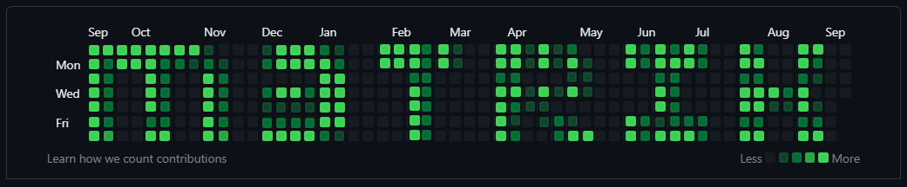

Tech-art tooling for game-art and DCC pipelines: one product of tools that behaves the same in Maya and Blender, built on general libraries that are each useful on their own.

**[pythontk](https://github.com/m3trik/pythontk) → [uitk](https://github.com/m3trik/uitk) → {[mayatk](https://github.com/m3trik/mayatk), [blendertk](https://github.com/m3trik/blendertk)} → [tentacle](https://github.com/m3trik/tentacle)**

| Repo | What it is |
|---|---|
| [pythontk](https://github.com/m3trik/pythontk) | Pure-Python primitives (files, images, video, audio, geometry, math) and the host-free models both DCCs share, such as the shot timeline and the scene-export records. No Qt, no DCC, no app SDK. |
| [uitk](https://github.com/m3trik/uitk) | A convention-driven Qt framework: *name it, and it connects.* Qt Designer files and Slots classes become working tools with no glue code. Generic: it names no DCC and no product. |
| [mayatk](https://github.com/m3trik/mayatk) | The Maya 2025+ library (`cmds` and OpenMaya, no PyMEL): host operations, every tool's Maya half, and bridges into Marmoset, Substance, RizomUV, Blender and Unity. No UI. |
| [blendertk](https://github.com/m3trik/blendertk) | The Blender 4.x+ library. It mirrors mayatk's public API by name and behavior, so one panel serves both hosts. No UI. |
| [tentacle](https://github.com/m3trik/tentacle) | The product: the marking-menu launcher (hold a key, flick toward a wedge, release) and every tool's panel and Slots class, for Maya, Blender and standalone use. Each tool's logic lives in the libraries below it. |
| [extapps](https://github.com/m3trik/extapps) | The engines of the standalone tools: photogrammetry, Substance Painter, Marmoset Toolbag, texture maps. Their panels are tentacle's. |

## Goals

1. **The tools work in harmony.** Maya and Blender expose the same operation under the same name, and one tool can use another's results.
2. **Each part is reusable on its own.** The marking menu, a panel, a script or another tool can call any operation, and a test can run it without a DCC.
3. **Each library stands on its own.** pythontk, uitk, mayatk and blendertk are useful to any developer on their platform, with no knowledge of this pipeline.
4. **Tools behave the way their users already expect:** the host's conventions (Maya: selection in, one undo step, option boxes; Blender: operator undo and redo), with progress, cancel, undo, preview and fixable errors.

## The rules, in brief

**Placement: libraries hold the logic, tentacle holds the UI.** A tool's operations live in mayatk and blendertk, mirrored. Logic both hosts share, and that is truly reusable, lives once in pythontk behind a small adapter each host implements. Generic Qt lives in uitk. tentacle holds the launcher, the UIs and the Slots classes, and reaches the host only through the library API. Dependencies point down only; no library imports tentacle.

**Construction: small parts, composed.**
- A large object is a facade over small collaborators that own their own state. A mixin is only for a capability several classes share.
- Host behavior is injected (an adapter, or the running toolkit `self.tk`), never a per-host subclass. A host class that binds a shared class may configure and add, never override.
- One shape at every scale: the same rules hold for a function, a tool and a package.

**Written once.** No copied code. The one exception is a copy across layers that cannot import each other, kept byte-identical by a check.

**Public APIs are contracts.** A removed or renamed public name gets a moved-names entry that tells the caller where it went, or a deprecation with a real removal version where callers need time. Saved names (settings keys, widget names, preset keys, scene-record names) keep their spelling, because scenes and presets outlive the code; a merged panel carries its old values over.

**Imports are lazy and have no side effects.** A package declares its names and imports none of them until first use. Other packages are reached through their root, never through a private module.

**Export is plug-and-play.** A deliverable is the authored scene written by a stock exporter, in open formats that pass their reference validators. A preview composes over the authored value; it never replaces it.

**Tests come from issues.** A bug gets a failing test first, then the fix; the test stays. Each change runs the affected tests; each release runs every suite, a fresh review, a GUI pass in a fresh Maya and Blender, and a production-scene check. Tests always launch a new DCC instance and never touch a user's open session.

**Checked, not just written.** Each rule a script can hold is a check, run in CI or by the release gate (`push.ps1`):

| Check | What fails |
|---|---|
| `check_layers.py` | An import against the layer order, or a role rule (a panel that imports a host) |
| `check_dcc_twins.py` | A body written twice, a drifted copy, a host binding that overrides shared behavior |
| `check_saved_names.py` | A saved widget or record name that disappeared |
| `generate_api_registry.py --semver` | A removed public name with no moved-names entry and no deprecation |
| `check_docs.py` | A broken link or an unreachable doc |
| `check_english_only.py`, `check_public_hygiene.py` | Non-English text; a private path or client name in a public repo |
| `check_temp_artifacts.py`, `check_context_budget.py` | A temp file outside its home; instruction files past their size caps |
| ruff | Errors in every package; in tentacle also oversized classes and functions, Qt imported past `qtpy`, PyMEL, and `print` |

The full text of every rule, with its reasoning: [`docs/CODE_STANDARD.md`](docs/CODE_STANDARD.md). The instructions coding agents follow live in each repo's `CLAUDE.md`; a rule change updates them, the standard and this summary together.

## This repo

PowerShell DevOps for the ecosystem: release automation, repo-maintenance scripts and the cross-package standards.

- **[`push.ps1`](push.ps1)**: the release path for the ecosystem packages (`pythontk`, `uitk`, `mayatk`, `blendertk`, `tentacle`). It makes one idempotent `Release X.Y.Z` commit per package (version stepped from what PyPI has, internal floors, fresh API registry), merges through a PR that fails fast on a red check, guards PyPI, tags versions, and writes GitHub Releases with the changelog notes since the previous tag. Re-running it completes any release an earlier run left merged but unfinished.
- **[`scripts/`](scripts/)**: the checks above, API-registry generation, Maya and Blender parity sweeps, and workspace inventory.
- **[`docs/`](docs/)**: the cross-package standards for [code](docs/CODE_STANDARD.md), [docs](docs/DOCS_STANDARD.md), the [context budget](docs/CONTEXT_BUDGET.md) and [test badges](docs/TEST_BADGE_STANDARD.md), plus the API shadow report.

Conventions and usage: [`CLAUDE.md`](CLAUDE.md).
