**Tech-art tooling for game-art and DCC pipelines.** One set of tools that works the same way in Maya and Blender, standalone apps for the work around them, and the libraries underneath, each useful on its own.

<!-- diagram:ecosystem -->
<!-- Generated by m3trik/scripts/generate_readme_diagrams.py from the workspace's declarations: change those and re-run it, never this block. -->
<picture>
  <source media="(prefers-color-scheme: dark)" srcset="https://raw.githubusercontent.com/m3trik/m3trik/main/docs/diagrams/ecosystem-dark.svg">
  <source media="(prefers-color-scheme: light)" srcset="https://raw.githubusercontent.com/m3trik/m3trik/main/docs/diagrams/ecosystem-light.svg">
  
</picture>
<!-- /diagram:ecosystem -->

## The products

| Product | What it does |
|---|---|
| [**tentacle**](https://github.com/m3trik/tentacle) | Marking menus and 50 tool panels for Maya and Blender: hold a key, press a mouse button, flick toward a command. Modeling, UVs, materials, rigging, animation, lighting and export, with bridges into Marmoset Toolbag, Substance 3D Painter, RizomUV, Unity and the other DCC. One file installs it in either app. |
| [**extapps**](https://github.com/m3trik/extapps) | Standalone apps that need no DCC: texture-map compositing, conversion and channel packing, photogrammetry and Gaussian splats, Substance 3D Painter, Marmoset Toolbag and Unity scripting, mesh conversion, a live WebXR preview for browsers and headsets, and look matching. tentacle's menus open nine of them by name. |

## The libraries

| Library | What it is |
|---|---|
| [**mayatk**](https://github.com/m3trik/mayatk) | The Maya 2025+ library, built on `maya.cmds` and OpenMaya with no PyMEL: every tool's Maya half, and the bridges to other apps. |
| [**blendertk**](https://github.com/m3trik/blendertk) | The Blender 4.x+ library. It mirrors mayatk's public API by name and behavior, so one panel drives both. |
| [**uitk**](https://github.com/m3trik/uitk) | A convention-driven Qt framework: *name it, and it connects.* A Qt Designer file and a Python class become a working tool with no glue code. The marking menu is one of its widgets. |
| [**pythontk**](https://github.com/m3trik/pythontk) | Pure-Python building blocks (files, images, video, audio, geometry, math) and the host-free engines both DCCs share: shot timelines, scene export, texture maps and lighting. No Qt, no DCC. |

**Get started:** download [`tentacle_installer.py`](https://github.com/m3trik/tentacle/releases/latest/download/tentacle_installer.py) and drag it into Maya's viewport, or install it as a Blender add-on. Every package is also on PyPI.

## How it's built

Every unit, from the workspace down to a single class, is built to the same shape: one purpose, a small public surface, a host-free core with a thin adapter for each host, and checks that prove its rules. Each choice below follows from it.

**One toolset, two DCCs.** mayatk and blendertk expose the same operations under the same names, with the same behavior, so a tool is written once and its panel serves both hosts: tentacle's menus and 48 of its 50 tool panels are shared. Where a host can't do something, the control is hidden there rather than left as a dead button. CI holds the pairing: it fails when a shared panel calls anything one library lacks without hiding that control, or when the same logic is written twice.

**Libraries hold the logic; panels stay thin.** Every operation is a public library function, and a panel only calls it. Anything a panel can do, a script, another tool, a test or an AI agent can do too, and much of it is tested without a DCC running. Logic both hosts share lives once in pythontk behind a small adapter each host implements, and dependencies point one way: no library imports the tools built on top of it.

**Name it, and it connects.** uitk turns a Qt Designer file and a Python class into a working tool: each widget calls the method that shares its name, its state persists between sessions, and the theme applies, all without glue code. The marking menu is a uitk widget too, and any Qt application can host it through a small adapter; tentacle is its showcase.

**Tools that feel native.** Maya tools take the selection, keep their settings in option boxes and undo in one step; Blender tools undo in one step too, in Blender's own history. Long jobs show progress and can be cancelled, and many tools preview their result live.

**Plug-and-play export.** A deliverable is the authored scene written by a stock exporter in an open format, one self-contained file per format. Lookdev aids and previews layer over the authored values; they never change what the exporter reads. The scene records that travel with an export are declared once, in pythontk, and read by Maya, Blender, Unity and the WebXR viewer, with the C# and JavaScript sides generated from that one declaration. glTF output is tested against the Khronos reference validator.

**Bridges that respect your session.** One-click hand-offs reach Marmoset Toolbag, Substance 3D Painter, RizomUV, Unity, the other DCC, and a browser or XR headset through the live WebXR preview. A bridge acts on an app you have open only when you invoke it, through a connection you enabled there and can see and switch off, and its edits land in that app's own undo.

**Ready for AI agents.** The libraries declare their operations: named, typed actions, each with a dry run, served on the command line (`python -m pythontk ops`) and over MCP, beside a live search of every package's public API. An agent plans a change before it makes it, and runs it in a Maya or Blender instance it launched itself, never in a session a person has open.

**Your work outlives the code.** Scenes, presets and settings outlast any version of the tools, so the names they store keep their spelling: when panels merge or are renamed, their saved values carry over, and a moved public function leaves an entry naming its new home. Checks hold both.

**Checked, not just written.** More than 30,000 tests run across the packages, and every bug gets a failing test before its fix. The rules a script can verify are checks in CI: dependency layers, logic written once, saved names, API compatibility and working doc links. Even the diagram above is generated from the packages' own declarations. The release script refuses to publish a changed package until a review and a full test run are recorded for the exact code it ships.

The full rules, each with its reasoning, are in the [code standard](docs/CODE_STANDARD.md); the [codebase manifest](docs/CODEBASE_MANIFEST.md) records the architecture and the decisions that shaped it.

## This repo

The ecosystem's release automation, maintenance scripts and shared standards.

- **[`push.ps1`](push.ps1)** releases the chained packages (pythontk, uitk, mayatk, blendertk, tentacle) in dependency order: one release commit per package, merged through a pull request that stops at the first failing check, published to PyPI, tagged, and announced in a GitHub Release written from the changelog. Every phase is idempotent, so running it again finishes whatever an interrupted run left. extapps publishes itself from its own workflow.
- **[`scripts/`](scripts/)**: the checks and generators, API-surface reports, and Maya and Blender parity sweeps.
- **Agent tooling**: the shared rule packs ([`agents/packs/`](agents/packs/)) and the Claude Code plugin ([`claude/`](claude/README.md)) with its review and sweep agents, the `/backlog` skill, hooks, and the MCP servers that serve the operations and the public API. Setup and use: [`docs/AGENT_INSTRUCTIONS.md`](docs/AGENT_INSTRUCTIONS.md).
- **[`docs/`](docs/)**: the standards for [code](docs/CODE_STANDARD.md), [docs](docs/DOCS_STANDARD.md), the [context budget](docs/CONTEXT_BUDGET.md) and [test badges](docs/TEST_BADGE_STANDARD.md), and the [codebase manifest](docs/CODEBASE_MANIFEST.md).

Conventions and usage: [`AGENTS.md`](AGENTS.md).

## Licenses

pythontk is MIT; mayatk is MIT with the Commons Clause; uitk and extapps are LGPL-3.0-or-later; blendertk and tentacle are GPL-3.0-or-later, each with an added permission to combine it with mayatk and Maya.
