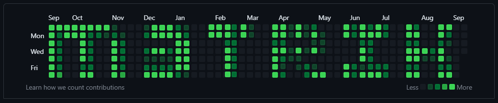
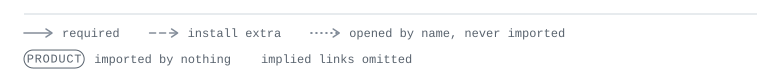

**Tech-art tooling for game-art and DCC pipelines.** Two products and the libraries beneath them, built as one architecture: one toolset that works the same way in Maya and Blender, standalone apps for the work around them, and one public API that artists, scripts, tests and AI agents all share.

<!-- diagram:ecosystem -->
<!-- Generated by m3trik/scripts/generate_readme_diagrams.py from the workspace's declarations: change those and re-run it, never this block. -->

<a href="https://github.com/m3trik/tentacle" title="Marking menus (pie menus) and tool panels for Maya and Blender: one hotkey-driven Qt interface for modeling, UV, animation and export."><picture><source media="(prefers-color-scheme: dark)" srcset="https://raw.githubusercontent.com/m3trik/m3trik/main/docs/diagrams/ecosystem-tile-r0-tentacle-dark.svg"><source media="(prefers-color-scheme: light)" srcset="https://raw.githubusercontent.com/m3trik/m3trik/main/docs/diagrams/ecosystem-tile-r0-tentacle-light.svg"></picture></a><a href="https://github.com/m3trik/extapps" title="Standalone Qt tools for content pipelines: texture map compositing and conversion, photogrammetry, Substance Painter and Marmoset Toolbag automation, Unity and WebXR hand-off, and mesh conversion."><picture><source media="(prefers-color-scheme: dark)" srcset="https://raw.githubusercontent.com/m3trik/m3trik/main/docs/diagrams/ecosystem-tile-r0-extapps-dark.svg"><source media="(prefers-color-scheme: light)" srcset="https://raw.githubusercontent.com/m3trik/m3trik/main/docs/diagrams/ecosystem-tile-r0-extapps-light.svg"></picture></a> 
<picture><source media="(prefers-color-scheme: dark)" srcset="https://raw.githubusercontent.com/m3trik/m3trik/main/docs/diagrams/ecosystem-tile-band0-dark.svg"><source media="(prefers-color-scheme: light)" srcset="https://raw.githubusercontent.com/m3trik/m3trik/main/docs/diagrams/ecosystem-tile-band0-light.svg"></picture> 
<a href="https://github.com/m3trik/mayatk" title="Python toolkit for Autodesk Maya: modeling, UV, materials, animation, rigging, lighting and scene-export utilities."><picture><source media="(prefers-color-scheme: dark)" srcset="https://raw.githubusercontent.com/m3trik/m3trik/main/docs/diagrams/ecosystem-tile-r1-mayatk-dark.svg"><source media="(prefers-color-scheme: light)" srcset="https://raw.githubusercontent.com/m3trik/m3trik/main/docs/diagrams/ecosystem-tile-r1-mayatk-light.svg"></picture></a><a href="https://github.com/m3trik/blendertk" title="Python toolkit for Blender mirroring mayatk&#x27;s API: modeling, UV, materials, animation, rigging and export utilities."><picture><source media="(prefers-color-scheme: dark)" srcset="https://raw.githubusercontent.com/m3trik/m3trik/main/docs/diagrams/ecosystem-tile-r1-blendertk-dark.svg"><source media="(prefers-color-scheme: light)" srcset="https://raw.githubusercontent.com/m3trik/m3trik/main/docs/diagrams/ecosystem-tile-r1-blendertk-light.svg"></picture></a> 
<picture><source media="(prefers-color-scheme: dark)" srcset="https://raw.githubusercontent.com/m3trik/m3trik/main/docs/diagrams/ecosystem-tile-band1-dark.svg"><source media="(prefers-color-scheme: light)" srcset="https://raw.githubusercontent.com/m3trik/m3trik/main/docs/diagrams/ecosystem-tile-band1-light.svg"></picture> 
<a href="https://github.com/m3trik/uitk" title="Convention-driven Qt UI toolkit for Python (PySide6 via qtpy): Designer .ui files or code-built UIs, signal-slot wiring by widget name, state persistence, custom widgets and presets."><picture><source media="(prefers-color-scheme: dark)" srcset="https://raw.githubusercontent.com/m3trik/m3trik/main/docs/diagrams/ecosystem-tile-r2-uitk-dark.svg"><source media="(prefers-color-scheme: light)" srcset="https://raw.githubusercontent.com/m3trik/m3trik/main/docs/diagrams/ecosystem-tile-r2-uitk-light.svg"></picture></a><picture><source media="(prefers-color-scheme: dark)" srcset="https://raw.githubusercontent.com/m3trik/m3trik/main/docs/diagrams/ecosystem-tile-r2-unitytk-dark.svg"><source media="(prefers-color-scheme: light)" srcset="https://raw.githubusercontent.com/m3trik/m3trik/main/docs/diagrams/ecosystem-tile-r2-unitytk-light.svg"></picture> 
<picture><source media="(prefers-color-scheme: dark)" srcset="https://raw.githubusercontent.com/m3trik/m3trik/main/docs/diagrams/ecosystem-tile-band2-dark.svg"><source media="(prefers-color-scheme: light)" srcset="https://raw.githubusercontent.com/m3trik/m3trik/main/docs/diagrams/ecosystem-tile-band2-light.svg"></picture> 
<a href="https://github.com/m3trik/pythontk" title="Python toolkit for DCC pipelines: files, math, geometry, images, video and audio, plus PBR texture, glTF/USD export and shot-timeline engines."><picture><source media="(prefers-color-scheme: dark)" srcset="https://raw.githubusercontent.com/m3trik/m3trik/main/docs/diagrams/ecosystem-tile-r3-pythontk-dark.svg"><source media="(prefers-color-scheme: light)" srcset="https://raw.githubusercontent.com/m3trik/m3trik/main/docs/diagrams/ecosystem-tile-r3-pythontk-light.svg"></picture></a> 
<picture><source media="(prefers-color-scheme: dark)" srcset="https://raw.githubusercontent.com/m3trik/m3trik/main/docs/diagrams/ecosystem-tile-legend-dark.svg"><source media="(prefers-color-scheme: light)" srcset="https://raw.githubusercontent.com/m3trik/m3trik/main/docs/diagrams/ecosystem-tile-legend-light.svg"></picture>

<!-- /diagram:ecosystem -->

Select a card to open its repo. The map is generated from the packages' own declarations.

## How it's built

Every unit, from the workspace down to a single class, has the same shape: one purpose, a small public surface, a host-free core with a thin adapter for each host, and checks that hold its rules. Everything below follows from that.

### One API behind every caller

<!-- diagram:one-api -->
<!-- Generated by m3trik/scripts/generate_readme_diagrams.py from the workspace's declarations: change those and re-run it, never this block. -->

<picture><source media="(prefers-color-scheme: dark)" srcset="https://raw.githubusercontent.com/m3trik/m3trik/main/docs/diagrams/one-api-dark.svg"><source media="(prefers-color-scheme: light)" srcset="https://raw.githubusercontent.com/m3trik/m3trik/main/docs/diagrams/one-api-light.svg"></picture>

<!-- /diagram:one-api -->

Every operation is a public library function that panels only call, so anything an artist can do, a script, a test or an AI agent can do too.

- **Thin panels.** The Scene Exporter panel holds no export logic: its one call reaches mayatk in Maya and blendertk in Blender, and both build on the same host-free core in pythontk.
- **The whole API, searchable.** `api.search` finds any public function or class across the packages, with its signature, its docs and the host it runs in. It reads the source and imports nothing.
- **Built for AI agents.** The search, a console in each host and the codebase's own upkeep are served over MCP and on the command line (`python -m pythontk ops`). An agent's calls run in a Maya, Blender or Unity instance the tooling launched for it, never in a session a person has open.
- **Plan, then apply.** An operation that changes anything returns its plan from one MCP server and makes the change on a second, so a client can allow every plan and still ask before each change. A result lists what changed, and a problem can name the call that fixes it.
- **Yours too.** In any project, `pip install "pythontk[mcp]" mayatk` and two `claude mcp add` lines give your agent the same tools for the packages you install.

### One toolset, two hosts

- **Mirrored by name and behavior.** mayatk and blendertk expose the same operations under the same names, so tentacle's menus and 48 of its 50 tool panels are shared. A control one host can't support is hidden there, never left as a dead button, and CI fails when a shared panel calls anything one library lacks.
- **Name it, and it connects.** uitk turns a Qt Designer file and a Python class into a working tool: each widget calls the method that shares its name, its state persists, and the theme applies, with no glue code. The marking menu is a uitk widget any Qt application can host.
- **Native in each host.** Maya tools take the selection, keep their settings in option boxes and undo in one step; Blender tools undo in one step too, in Blender's own history. Long jobs show progress and can be cancelled, and many tools preview their result live.

### Robust

- **Plug-and-play export.** A deliverable is the authored scene written by a stock exporter in an open format, one self-contained file per format, and glTF output is tested against the Khronos reference validator. Previews and lookdev aids layer over the authored values; they never change what the exporter reads.
- **One contract, every reader.** The scene records that travel with an export are declared once, in pythontk, and read by Maya, Blender, Unity and the WebXR viewer, whose C# and JavaScript types are generated from that one declaration.
- **Bridges that respect your session.** One-click hand-offs reach Marmoset Toolbag, Substance 3D Painter, RizomUV, Unity and the other DCC. A bridge acts on an app you have open only when you invoke it, through a connection you enabled and can switch off, and its edits land in that app's own undo.
- **Your work outlives the code.** Scenes, presets and settings outlast any version of the tools: when panels merge or are renamed, their saved values carry over, and CI fails on a stored name that would stop loading.

### Maintainable

- **Dependencies point one way.** Each package declares the order of its parts, and CI fails an import, or even a name, that reaches up a layer. No library imports a product.
- **Written once.** Logic both hosts share lives in pythontk behind a small adapter each host implements, and CI fails when the same logic is written twice.
- **Checked, not just written.** More than 30,000 tests run across the packages, and every bug gets a failing test before its fix. The rules a script can verify are checks in CI, down to working doc links.
- **Releases that prove themselves.** The release script measures each package's public-API change against the published version: it refuses to ship a removal as a patch, or one that leaves callers no pointer to the new home, and it publishes only code with a review and a full test run recorded against it.

The rules, each with its reasoning, are in the [code standard](docs/CODE_STANDARD.md); the [codebase manifest](docs/CODEBASE_MANIFEST.md) records the architecture and the decisions that shaped it.

## This repo

The ecosystem's release automation, maintenance scripts and shared standards.

- **[`push.ps1`](push.ps1)** releases the chained packages (pythontk, uitk, mayatk, blendertk, tentacle) in dependency order: one release commit per package, merged through a pull request that stops at the first failing check, published to PyPI, tagged, and announced in a GitHub Release written from the changelog. Every phase is idempotent, so running it again finishes whatever an interrupted run left. extapps publishes itself from its own workflow.
- **[`scripts/`](scripts/)**: the checks and generators, API-surface reports, and Maya and Blender parity sweeps.
- **Agent tooling**: the shared rule packs ([`agents/packs/`](agents/packs/)) and the Claude Code plugin ([`claude/`](claude/README.md)) with its review and sweep agents, the `/backlog` skill, hooks, and the MCP servers that serve the operations and the public API. Setup and use: [`docs/AGENT_INSTRUCTIONS.md`](docs/AGENT_INSTRUCTIONS.md).
- **[`docs/`](docs/)**: the standards for [code](docs/CODE_STANDARD.md), [docs](docs/DOCS_STANDARD.md), the [context budget](docs/CONTEXT_BUDGET.md) and [test badges](docs/TEST_BADGE_STANDARD.md), and the [codebase manifest](docs/CODEBASE_MANIFEST.md).

Conventions and usage: [`AGENTS.md`](AGENTS.md).

## Licenses

pythontk is MIT; mayatk is MIT with the Commons Clause; uitk and extapps are LGPL-3.0-or-later; blendertk and tentacle are GPL-3.0-or-later, each with an added permission to combine it with mayatk and Maya.
